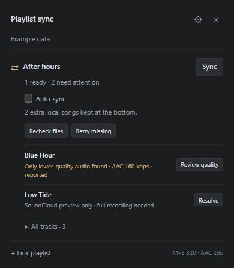
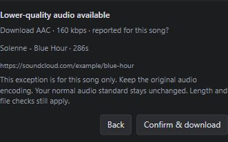

# Playlist Sync for rbxport

Sync Spotify and SoundCloud playlists from a small popup beneath **Tag List**. Reuse your existing songs, find missing recordings and keep the source playlist's order.

**Windows x64 · Experimental v0.11.5 · Node.js 24 or newer required for setup · Tested host: rbxport 1.9.0**

**Install Node.js first:** Download and install the official [Node.js runtime](https://nodejs.org/en/download), version 24 or newer. The add-on ships as one **`.mjs` setup file**. Run it with Node; double-clicking it may open an editor. You do not need to unpack the source ZIP. Setup installs its own verified private runtime for subsequent rbxport launches.

**[Download Windows setup](https://github.com/ElmoTuisk/rbxport-playlist-sync/releases/latest)** · [Report an issue](https://github.com/ElmoTuisk/rbxport-playlist-sync/issues) · [Changelog](CHANGELOG.md)

<table>
  <tr><th>Compact popup</th><th>Quality review</th></tr>
  <tr>
    <td></td>
    <td></td>
  </tr>
</table>

*Actual interface with fictional example data.*

## Quick start

1. Install [rbxport for Windows](https://github.com/chrisle/rbxport/releases/latest).
2. Install [Node.js 24 or newer](https://nodejs.org/en/download), then download **`playlist-sync-0.11.5-windows-setup.mjs`** from [Releases](https://github.com/ElmoTuisk/rbxport-playlist-sync/releases/latest).
3. Close rbxport. Open a terminal in the download folder and run `node .\playlist-sync-0.11.5-windows-setup.mjs`. Review the installation/data folders and enter **y** to install or update. Internet is required; administrator access is not. Setup verifies its tools and connects your regular rbxport shortcuts.
4. Open rbxport from its regular Start Menu or Desktop shortcut, then click **Playlist sync** below **Tag List**. The setup file is only needed for installation and later updates.
5. Choose **+ Link playlist**, paste a Spotify/SoundCloud URL and select an existing playlist or create one. Review the preview, then click **Sync**.

The default setup connects your original per-user **rbxport** Start Menu and Desktop shortcuts to every enabled add-on: Playlist Sync and, if separately installed and enabled, Playlist Wizard. Opening either starts one host and both services; closing that host cancels their work and stops them. Integration removes conventional separate add-on and sign-in shortcuts. The rbxport name and original executable icon are retained. Use `Configure-Rbxport-Startup.ps1` to enable this later. Customized shortcuts are preserved; restore an ordinary rbxport shortcut if configuration reports a conflict. Direct executable and older Store launches bypass the wrapper.

The startup path uses `scripts/Start-Rbxport.mjs` directly through official Node.js; it does not compile or run a custom launcher EXE. The shortcut starts a minimized, short-lived Node parent, then a hidden worker starts both services concurrently. A brief minimized console may be visible; this is not a guarantee of console-free startup. PowerShell remains for installation/configuration and one fixed, read-only host-process inventory command. Startup failures open their private diagnostic text in Windows Notepad. [Startup and signing policy](docs/code-signing.md).

On 24 October, native Explorer launches of the installed Desktop and Start Menu shortcuts verified both add-ons, both popups and normal close/reopen on rbxport 1.9.0, with saved state unchanged. The check also caught and repaired packaged-tool AppData redirection; the final shortcuts use physical user files. This verifies startup on this machine; clean-machine JavaScript installation remains unverified. [Verification details](docs/validation.md).

### Install, update and uninstall

Every JavaScript release provides one **`playlist-sync-<version>-windows-setup.mjs`**, public source and SHA-256 checksums. Install official Node.js 24 or newer once, then run the setup using `node <downloaded-file.mjs>`. Extraction, the private runtime and checksum-verified audio tools are handled automatically. Windows x64, internet and an existing compatible rbxport installation are required. Administrator access is not required. Windows protections stay enabled; a script is not a promise of compatibility with every application-control policy.

Updates remove obsolete program files only when their previous ownership and checksums match; recognized legacy setup scripts are also removed. Edited files, unknown files and saved data are retained.

For an update, close rbxport and run the new `.mjs` file with Node. Setup finds the existing copy through its registration, shared startup settings or the standard folder, updates it in place and retains its saved-data location. It can stop an idle service belonging to that exact installation; active work and unrelated running copies block the update. For an unregistered portable copy or multiple detected copies, add `--existing-directory "C:\path\to\installed-addon"`. Use `--help` for the supported folder/cache options. No automatic updater is installed.

JavaScript setup configures the original rbxport Desktop and Start Menu shortcuts after showing that change in its confirmation. Disabling or uninstalling one add-on keeps the shared launcher working for the other; disabling the last restores unchanged original shortcuts byte for byte. The host executable is unchanged. Answer **n** to cancel before installation, or use **Ctrl+C** during setup to request cancellation and program-file recovery. Saved data and music are never setup payloads.

Remove a managed installation through **Playlist Sync → gear → Uninstall Playlist Sync**, or Windows **Installed apps**. Confirming removes its program files, shortcuts and its own startup registration; music, playlists, saved settings and Playlist Wizard are retained. Finish or cancel any sync first. Edited/unrecognized files are retained. Updating an older portable copy through JavaScript setup adds this uninstall option.

The complete source, including the installer, remains public. Releases include the single `.mjs` setup, a source ZIP and SHA-256 checksums after Windows and Linux CI pass. This path builds no custom setup EXE and does not wait for a signing certificate. Optional native EXE builds retain their separate signing/validation gates. The Node runtime remains unchanged and publisher-signed; our JavaScript is not represented as Authenticode-signed. [Distribution and signing details](docs/code-signing.md).

## What it does

- **Reuses songs** from your whole collection, including other playlists.
- **Keeps source order**, with extra local songs at the bottom. No automatic music deletion.
- **Checks audio quality**, with individual or bulk approval for lower-quality streams.
- **Adds cover art**, bulk review and optional hourly auto-sync while the app/service run.

Expand a topic for setup and details.

**[Playlist Wizard](https://github.com/ElmoTuisk/rbxport-playlist-wizard)** is a separately installed add-on for autosorting hand-picked songs and building DJ sets with selectable energy curves and lengths. Both can use the original rbxport shortcut while retaining independent services and saved data. Wizard is not included in the Playlist Sync setup.

<strong>Spotify & SoundCloud</strong> — accounts and playlist access

Public SoundCloud playlists usually need no sign-in. Spotify uses your account or a public page only when its complete track list can be verified.

For Spotify, create an app in the [developer dashboard](https://developer.spotify.com/dashboard), register **`http://127.0.0.1:43821/oauth/spotify`**, then enter its **Client ID** under **gear → Connect Spotify**. No client secret is needed. Large/private playlists may need an eligible account.

[Full account setup and restrictions](docs/usage.md#spotify-setup-optional).

<strong>Existing songs & ordering</strong> — reuse files and review matches in bulk

**Recheck files** refreshes saved matches without downloads or playlist writes. **Accept suggested matches → Accept N & reorder** reviews local files in bulk and applies source order. Different lengths/versions require an explicit choice; extras retain their order at the bottom.

Deleting a target clears its add-on link after a successful library check, while keeping music and reusable collection bindings.

[Bulk matching](docs/usage.md#accept-existing-matches-in-bulk) · [Playlist cleanup](docs/usage.md#deleting-a-playlist).

<strong>Missing songs</strong> — retries, source URLs and Soulseek

**Retry missing** checks local files, SoundCloud originals/search, Newgrounds and YouTube, then optional Soulseek. **Resolve** shows source attempts and lets you select an existing song, file, another URL, retry or ignore.

Enable Soulseek under **gear → Soulseek fallback** with your existing account; its helper installs automatically. Online availability does not guarantee an accessible file at your selected quality. Protected, preview-only, wrong-version and broken files stay blocked.

The add-on also offers **gear → Advanced → Spotisaver for Spotify tracks**: **Off**, **Last resort, after Soulseek**, or **Try first, then other sources**. Last resort runs only after web discovery and enabled Soulseek supply no verified file; with Soulseek disabled, it follows web discovery. It requires an actual 320 kbps MP3 and preserves that audio without re-encoding. Original source quality stays labelled **unverified**. Use **Verify Spotisaver** to open its dedicated Edge/Chrome window, finish any verification, then retry in the app. Keep that window open or minimized. Three selected live recordings passed the 320 kbps checks; broader reliability remains unproven. The option defaults off. [Connection details and limitations](docs/spotisaver.md).

[Missing-song actions](docs/usage.md#missing-songs--check-source) · [Soulseek setup](docs/usage.md#soulseek-fallback).

<strong>Audio quality</strong> — standards, bulk approval and official downloads

Default: **MP3 320 kbps / lossless**. You can also allow **AAC 256 kbps** under the gear. Identity, version, length, stereo, sample rate and complete decoding are checked. A reported bitrate or 320 kbps output alone does not prove source quality.

Ordinary lower-quality audio needs **Review quality → Confirm & download**, or **Accept lower quality… → Accept N & download** for a reviewed batch. These exceptions retain the real source quality and leave your global standard unchanged.

Artist-enabled SoundCloud originals are tried first and accepted at their original bitrate by default, including lower quality with a clear label. This can be disabled in Advanced settings; sign-in/cookies may be needed. External download gates are not submitted automatically.

[Quality approval](docs/usage.md#accept-lower-quality-songs-in-bulk) · [Official downloads](docs/usage.md#soundcloud-official-downloads).

<strong>Album covers</strong> — artwork embedded in new downloads

New MP3/M4A/approved FLAC downloads embed the exact Spotify album or SoundCloud track artwork, preserving existing attached covers as fallback. Missing artwork keeps verified audio and shows **cover unavailable**. Existing collection files are not rewritten.

[Artwork details](docs/usage.md#embedded-album-covers).

<strong>Updates & stopping</strong> — keep saved settings and music

**Stop:** close rbxport normally. Its add-on services stop with it. For a legacy standalone service, use `Stop-Playlist-Sync.ps1` from its installed folder.

**Update:** stop the add-on and run the latest setup EXE. It updates the detected installation; use **Choose existing folder** for an unregistered portable copy. Saved links, settings, accounts and music are preserved. Updates are manual; matching program files are overwritten, but obsolete files are not yet removed automatically.

Updating rbxport is separate and may require an add-on update. Reopen through the integrated rbxport shortcut afterward. Keep the data folder, normally `%LOCALAPPDATA%\rbxport-playlist-sync`, private.

[Update and recovery details](docs/usage.md#stop-or-update).

<strong>Troubleshooting</strong> — missing panel and connection errors

**No panel?** With automatic attachment configured, open compatible rbxport and allow up to 20 seconds. Otherwise open the **Playlist Sync** shortcut. Look below Tag List; its background service must remain running. If you enabled startup while rbxport was already open without a local connection, close and reopen rbxport normally once.

**Library error?** rbxport **1.9.0** is tested; Store **0.19.3** lacks the required library API. The popup shows the problem and disables library actions. Old host errors clear after a verified reconnect; **Recheck files** refreshes song matches.

This independent add-on uses a local automation connection, without an official plugin loader. Later host updates may affect compatibility. Mac and ARM64 setup are not supported.

[Connection guidance](docs/usage.md#stop-or-update) · [Report an issue](https://github.com/ElmoTuisk/rbxport-playlist-sync/issues).

<strong>Technical details & limitations</strong> — performance, testing and development

Hidden/unchanged renders are skipped, metadata caches are bounded and acquisition runs serially. Downloads and analysis still use resources while active.

Fully inspected search results now arrive as they are ready. SoundCloud/YouTube metadata searches overlap, with at most two providers active; source preference and all recording/audio checks stay the same. Unused searches are cancelled. [Search performance and test evidence](docs/validation.md#faster-candidate-discovery-0105).

A 95% completion rate has **not** been established. Downloads, existing-file reuse and quality holds are counted separately. Only acquire audio you are entitled to download; format checks cannot prove a file was never upscaled before acquisition.

[Detailed usage](docs/usage.md) · [Project overview](PROJECT_OVERVIEW.md) · [Architecture](docs/architecture.md) · [Validation](docs/validation.md) · [Playlist testing](docs/playlist-testing.md) · [Development guide](docs/addon-guide.md) · [Contributor notes](AGENTS.md)

GPL-2.0-or-later · [License](LICENSE) · Independent add-on for [rbxport](https://github.com/chrisle/rbxport).
